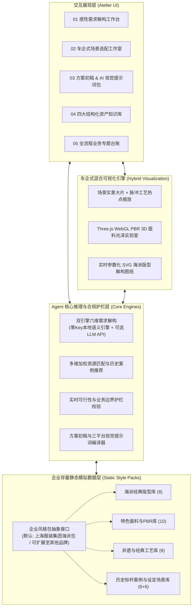
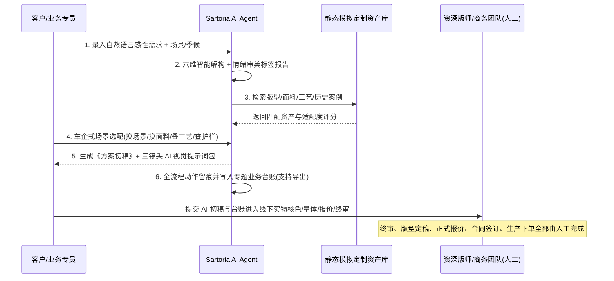

# Sartoria AI 完整方案文档

> **命题方板块**：上海服装集团 · 服装板块  
> **赛道归属**：AI+消费（IP类情绪消费 · 新消费）  
> **对应业务**：定制业务专员、职业服方案设计师、高级定制企划人员  
> **原型数据声明**：本系统 100% 基于企业存量静态模拟定制数据运行，不对接任何生产系统、ERP/PLM 或外部真实业务 API。

---

## 1. 业务背景与核心痛点剖析

在上海服装集团「海派高级定制」与「团体职业服定制」双轮驱动业务中，客户消费已从传统功能穿着全面升级为**场景化情绪消费与文化身份表达**。然而，一线企划与洽谈环节仍普遍面临五大结构性痛点：

| 痛点维度 | 现状与业务瓶颈 | Sartoria AI 破局价值 |
| --- | --- | --- |
| **感性需求难转化** | 客户表达碎片化、情绪化（如“不老气的海派电影感”“权威又不死板”），高度依赖资深顾问个人经验转译 | 六维智能解构引擎即时输出「风格调性、廓形要求、面料质感、工艺细节、色彩体系、场景适配度」参数清单与情绪标签报告 |
| **存量资产难检索** | 海派经典版型、非遗工艺、特色面料与历史案例散落于图册与老师傅经验中，复用效率低 | 构建四大结构化静态定制资产知识库（支持企业风格包扩展），实现标签化检索与加权匹配 |
| **可视化周期长** | 缺少即时、贴近真实穿着场域的视觉参考，客户意向确认慢、签单周期长、样衣试错成本高 | 创新引入**车企选配式「三视角混合舞台」**：设定场景实景切换 + 工艺热点镜头缩放 + Three.js 3D PBR 面料光泽实验室 + 参数化版型图纸 + 三平台标准化 AI 绘图提示词包 |
| **方案输出无标准** | 新人企划上手慢，输出文档格式不统一，海派风格体系难以规模化沉淀 | 一键生成含设计亮点、适配说明与可行性风险护栏的《海派定制整体方案初稿》 |
| **业务台账难复盘** | 需求沟通、资源调用与方案版本依赖手工表格，历史案例难以复盘与二次复用 | 全流程动作自动留痕，支持人工复核流转、在线编辑备注及 CSV/JSON/打印报告导出 |

---

## 2. 系统总体架构设计

Sartoria AI 采用「**静态企业资产知识库层 + 双引擎智能推理与护栏层 + 车企式三视角可视化选配层 + 全流程台账留痕层**」四层解耦架构：

### 2.1 核心技术创新设计

1. **车企选配式「三视角混合舞台」**：
   - 调研业内 `React Three Fiber` 开源 3D 服装配置器与 Suitsupply / Porsche Studio 选配架构后发现：开源低精度 `.glb` 服装网格缺乏海派盘扣、宋锦暗纹与真实丝绸垂坠，置于晚宴场景极易失真。
   - 因此 Sartoria AI 创新采用**混合选配架构**：
     - **视角一（场景氛围实景）**：将定制成衣置身于外滩老洋房晚宴、静安艺术沙龙、陆家嘴金融峰会、涉外礼宾厅等设定场景中，支持主推面料实景换装、环境光色温联动及点击服装热点锚点平滑推进镜头查看局部工艺。
     - **视角二（工艺微距与 Three.js 3D 面料实验室）**：基于 Three.js `MeshPhysicalMaterial`（`sheen` / 程序化织纹法线贴图）实时模拟丝绸、宋锦、香云纱丝绒与精纺羊毛的物理垂感与光泽，并跟随所选场景灯具色温（如 2900K 外滩暖金吊灯 vs 5600K 陆家嘴建筑天光）动态反射高光。
     - **视角三（实时参数化 SVG 版型图纸）**：针对知识库内任意版型 × 面料 × 工艺组合 100% 动态重绘廓形、领型、盘扣、3mm 镶滚线、苏绣点位与全毛衬结构线。
2. **双引擎推理机制（保障路演 100% 稳定与泛化兼得）**：
   - 默认运行**零 Key 本地领域语义引擎**，离线断网环境毫秒级响应；
   - 同时支持在设置面板中按需填入 OpenAI 兼容 API（如 DeepSeek / OpenAI / Qwen），将客户自由输入的任意感性描述交由大模型深度解构，异常时自动无缝回退本地引擎。
3. **企业风格包灵活扩展机制（Style Pack Schema）**：
   - 资产与规则均通过 `stylePackId` 隔离挂载，默认内置「上海服装集团 · 海派高定与职业服风格包」，并内置「新锐极简商务扩展风格包」演示多品牌、跨风格体系的零代码资产扩展能力。

---

## 3. 端到端业务流程与双案例闭环剧本

### 3.1 六步企划闭环流程

### 3.2 内置 6 套完整模拟业务案例（全面融合官方案例 1–4 + 团装与晚宴高定）

系统默认支持将任意自然语言需求直接转译为官方标准 **8 项专业定制参数**（`【品类】【版型结构】【领型】【面料】【色彩】【装饰纹样】【长度比例】【松弛余量】`），同时保留赛题要求的 **6 维情绪审美雷达图** 一键切换查看。

| 案例编号 | 业务板块 | 核心客户痛点与体态工学 | 专业语言转化与选配看点 |
| --- | --- | --- | --- |
| **官方案例 01** | **高端私定 · 正式外套** | 中式端庄外套；脖子短领子不能太高；有肚腩需宽松舒适不紧绷 | H 型直身无收腰 + 微落平肩 + 低立领 ≤3cm 圆润领线 + 醋酸/薄款提花锦（挺而不硬不贴腹）+ 臀中衣长 + 前片腹部充足松量 |
| **官方案例 02** | **高端私定 · 优雅外套** | 正式中式外套；窄领显脖细；需配内搭；偏好梅花暗纹 | H 型微收腰 + 窄青果西装领 + 提花宋锦 + 植物梅花暗花与细碎点状星光 + 整体宽松舒展 |
| **官方案例 03** | **舞台演出 · 两件式套装** | 户外舞台氛围感；演奏抬手与坐奏方便；腰部宽松、明快上镜 | 米白暗纹宋锦斜襟短外套（亮粉滚边撞色袖口 + 宽袖管抬臂放量）+ 亮粉亮面缎面收腰大 A 摆及踝连衣裙（坐奏舒展） |
| **官方案例 04** | **私定外套 · 内敛简约** | 低调简约中式外套；短颈 + 轻微溜肩 + 小肚腩 | H 型无收腰 + 自然落肩修饰溜肩 + 低立领 ≤3cm + 非遗原生哑光香云纱 + 前片腹部充足松量 |
| **团装案例 05** | **团体职业服定制** | 陆家嘴资管集团 60 人男女高管与涉外礼宾；权威干练、抗皱耐穿、融入海派基因 | 陆家嘴金融峰会 / 外滩礼宾厅实景切换 + 外滩藏青 / 石库门暖灰 / 松墨绿三色系比对 + 团单娇贵面料风险护栏 |
| **晚宴案例 06** | **海派高定 · 晚礼服** | 外滩百年老洋房艺术慈善晚宴；老上海电影感、克制鎏金不老气 | 外滩晚宴 ↔ 静安艺术沙龙切换 + 墨黛宋锦 / 月白织锦缎 / 绯红丝绒实景换装 + 琵琶盘扣与玉兰苏绣热点特写 |

---

## 4. 定制资产知识库数据标准（存量静态模拟数据）

系统当前沉淀 4 大核心结构化资产集与 6 大高频场景环境，全部以结构化 TypeScript/JSON 静态模型存放于 `src/data/`，支持导出《定制资源分类清单（CSV）》：

- **海派经典版型库（8 款）**：涵盖编码（`SFG-PT-001`–`008`）、业务板块、廓形、领型、肩型、体型适配指引、适用场景、基准参考工期及参数化图纸几何配置。
- **特色面料库（10 款）**：涵盖编码（`SFG-FB-101`–`301`）、成分、克重（`g/m²`）、织法、光泽度、悬垂性、适季性、护理/团单耐穿标识及 WebGL PBR 物理材质参数。
- **非遗与经典工艺库（8 款）**：涵盖编码（`SFG-CR-001`–`008`）、非遗/精工等级、适配部位、额外参考工期、织法兼容规则、热点锚点坐标与工艺微距图。
- **历史案例库（6 套）**：沉淀过往海派私定与团体职业服标杆案例的资产组合与复盘摘要，支持在选配工作室“一键复用资产组合”。

---

## 5. 分阶段落地路径（Roadmap）

1. **Phase 1 · 企划辅助与知识库标准化（当前黑客松阶段）**
   - 建立四大存量静态定制资产标准 Schema 与企业风格包模型；
   - 上线车企式场景选配预览、六维需求解构、可行性护栏、三平台 AI 提示词包与可导出业务台账；
   - 严守“纯辅助草稿、零生产直连”合规基线，赋能门店顾问与团装企划新人快速上手。
2. **Phase 2 · 企业级数字资产沉淀与高保真 3D 联动（3–6 个月）**
   - 联合上海服装集团版型中心与面料供应链，逐步导入企业脱敏历史样衣与标准色卡 PBR 扫描数据；
   - 预留 CLO 3D / Marvelous Designer `.glb` 数字样衣接入规范，升级选配舞台至全角度 3D 虚拟试衣，并打通内部合规生图服务实现一站式效果图直出。
3. **Phase 3 · 协同企划工作流集成（6–12 个月）**
   - 在通过信息安全与权限审计后，以只读同步或人工审批触发方式对接企业 CRM / 企划评审系统，实现企划台账一键流转至线下版师量体与商务报价审批流（仍保留人工终审闸口）。

---

## 6. 风险评估与合规治理说明

| 风险类别 | 潜在业务/技术风险 | 应对与控制机制 |
| --- | --- | --- |
| **视觉色差与预期偏差** | AI 效果图与显示屏光影可能与真实面料米样存在色差 | 方案初稿、视觉包与舞台均显式提示“仅供参考，终审须对照工坊高显色光源下实体米样色卡核色” |
| **越权报价或交期承诺** | 客户误将 AI 辅助方案中的参考周期视为正式商业承诺 | 全系统剔除报价与下单功能；工期仅标注“参考基准周期，须工坊与业务人员核定”；方案纸面加盖「AI 企划参考初稿」印章 |
| **工艺与面料物理冲突** | 新人企划误选不兼容面料与工艺（如团装选娇贵纯丝、夏季选 340g 重磅羊毛） | 内置实时可行性护栏规则引擎，即时标红预警并提示人工版师复核 |
| **企业数据隐私与外泄** | 客户量体数据或企业商业底价流入公网模型 | 原型 100% 使用静态模拟数据；默认零外网本地语义引擎运行；可选 LLM 密钥仅由用户本地临时配置且不落盘代码库 |

---

## 7. 《Agent 能力边界清单》（独立章节）

为严格恪守上海服装集团对定制业务专业性、商业风控与生产安全的管理要求，Sartoria AI 明确划定以下人机权责边界：

| 业务环节 | Agent 允许执行的能力范围（AI 辅助） | Agent 明确禁止越界事项（红线） | 人工终审责任岗 | 系统内建合规护栏 |
| --- | --- | --- | --- | --- |
| **1. 需求采集与理解** | 接收自然语言感性描述；输出六大维度结构化参数清单与客户情绪审美标签报告 | 不替代顾问进行客户正式需求确认签字；不采集/存储真实客户敏感身份证件或隐私尺寸档案 | 定制业务专员 / 高定企划人员 | 标注「AI 解析草稿」，所有字段支持人工审阅与修改 |
| **2. 资产匹配与选配** | 检索静态模拟资产库；计算版型/面料/工艺/场景匹配度；提供车企式场景选配与可行性风险提示 | 不替代版师锁定最终生产纸样、放缝尺寸与特体修正参数 | 职业服方案设计师 / 资深版师 | 选配底栏与方案页强制展示可行性风险预警与「待版师复核」清单 |
| **3. 方案初稿与视觉辅助** | 生成定制整体参考方案初稿；输出适配 Midjourney/Flux/即梦 的三镜头标准化视觉提示词与需求包 | 不以 AI 预览图替代实物面料米样确认与毛样试身；不对外发布未审核视觉素材 | 高定企划人员 / 门店顾问 | 企划书纸面加盖「AI 企划参考初稿 · 待人工终审」水印印章 |
| **4. 商务决策与签约** | 展示基于静态数据的参考周期与护理起订说明供内部沟通参考 | **严禁**对外生成正式报价单、审批商业折扣、承诺违约交期、签订定制合同或触发支付收款 | 定制业务专员 / 商务经理 | 系统全链路无报价单、无支付、无合同签署入口 |
| **5. 业务台账与生产衔接** | 记录企划全流程动作留痕；管理人工复核状态；支持导出 CSV/JSON/打印报告用于内部复盘与上报 | **严禁**对接真实 ERP/MES/PLM 生产系统；严禁自动向工厂/工坊下发裁剪或排产指令 | 团装/高定业务负责人 | 台账状态流转止步于「待版师/报价终审 → 已归档」，全程使用静态模拟数据 |

> **边界总结**：Sartoria AI 的核心价值在于将高定与团装企划前期的**感性转化、存量检索、场景可视化与台账留痕效率提升 3–5 倍**，同时将**审美品控终审、量体定版、商务报价与生产交付** 100% 保留在经验丰富的业务与匠人团队手中，真正实现安全可控、人机协同的垂直领域业务落地。
